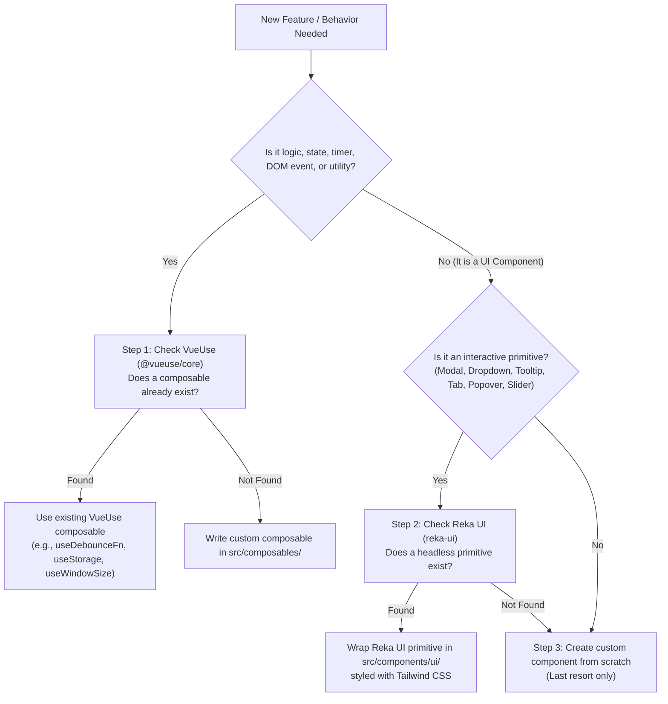

# Frontend Architecture & Design Guide

This document outlines the core frontend architecture, library stack, component guidelines, and implementation hierarchy for the **FIRMS Wildfire Harmonizer** web application.

---

## 1. Technology Stack Overview

| Category | Library / Tool | Version | Purpose in Application |
| :--- | :--- | :--- | :--- |
| **Framework** | [Vue 3](https://vuejs.org/) | `^3.5` | Reactive UI using Composition API (`<script setup lang="ts">`). |
| **Build Tool** | [Vite](https://vite.dev/) | `^8.2` | Fast dev server, HMR, and production bundling. |
| **State Management** | [Pinia](https://pinia.vuejs.org/) | `^4.0` | Centralized reactive store for active filters, query results, and calendar state. |
| **Styling** | [Tailwind CSS v4](https://tailwindcss.com/) | `^4.3` | Modern utility-first CSS via `@tailwindcss/vite` and `@import "tailwindcss";`. |
| **UI Primitives** | [Reka UI](https://reka-ui.com/) | `^2.0` | Accessible, unstyled headless component primitives (formerly Radix Vue). |
| **Composables** | [VueUse](https://vueuse.org/) | `^15.0` | Essential reactive utility composables (sensors, state, timers, DOM). |
| **Map Engine** | [MapLibre GL JS](https://maplibre.org/) | `^5.1` | WebGL-accelerated interactive map rendering thousands of hotspots. |
| **Spatial Tools** | `@mapbox/mapbox-gl-draw` & `@turf/turf` | `^1.5` / `^7.2` | Interactive polygon/BBox drawing & geospatial area calculations. |
| **Satellite Imagery** | [Esri World Imagery](https://server.arcgisonline.com/) | REST XYZ | 100% free high-resolution optical satellite basemap (zoom up to 19). |
| **Typing & Linting** | TypeScript, `vue-tsc`, Oxlint, ESLint | Latest | Strict types, lightning-fast Rust linting (Oxlint), and Vue ESLint rules. |

---

## 2. Implementation Decision Hierarchy (The "Check First" Rule)

To prevent code bloat, reinventing the wheel, or accumulating technical debt, all developers must strictly follow this decision ladder before building any new UI or utility feature:



### Hierarchy Rules:
1. **Always Check VueUse First**:
   - Before writing custom reactive watchers, debounce/throttle wrappers, local storage sync, resize listeners, interval clocks, or intersection observers, check [VueUse documentation](https://vueuse.org/functions.html).
2. **Always Check Reka UI Second**:
   - Before building interactive UI controls (dialogs, select dropdowns, popovers, tooltips, accordions, tabs, toggle groups, sliders), check [Reka UI documentation](https://reka-ui.com/). Do not write manual DOM accessibility, focus traps, or keyboard navigation from scratch.
3. **Custom Components as Last Resort**:
   - Build a component from scratch only if neither VueUse nor Reka UI provides the required functionality (e.g., custom SVG fire gauges, specialized GIS timelines).

---

## 3. Component Architecture: Dumb vs. Logic Components

We maintain a strict separation of concerns across all components:

### A. Dumb (Presentational) Components (`src/components/common/`, `src/components/ui/`)
* **Role**: Pure visual presentation and user interaction.
* **Characteristics**:
  - Accept all data via typed `defineProps<{ ... }>()`.
  - Report user actions via `defineEmits<{ ... }>()`.
  - **Zero** direct store dependencies (never import Pinia stores directly).
  - **Zero** side-effects (no API requests, no router mutations).
  - Easy to test in isolation and showcase in Storybook.
* **Examples**:
  - `FirePopup.vue`: Renders hotspot attributes and emits an `inspect` event.
  - `MetricCard.vue`: Displays a title, numerical value, and icon.
  - `CalendarCell.vue`: Renders a month's burn activity color block and emits click.

```vue
<!-- Example: Dumb Presentational Component -->
<script setup lang="ts">
defineProps<{
  label: string
  count: number
  variant?: 'danger' | 'warning' | 'info'
}>()

const emit = defineEmits<{
  (e: 'click'): void
}>()
</script>

<template>
  <button
    type="button"
    class="p-3 rounded-lg border text-left transition cursor-pointer"
    :class="variant === 'danger' ? 'bg-red-950/40 border-red-800 text-red-200' : 'bg-neutral-900 border-neutral-800 text-white'"
    @click="emit('click')"
  >
    <span class="text-xs text-neutral-400 block">{{ label }}</span>
    <span class="text-xl font-bold font-mono">{{ count.toLocaleString() }}</span>
  </button>
</template>
```

### B. Logic (Smart / Container) Components (`src/components/features/`, `src/views/`)
* **Role**: State orchestration, store connection, and spatial queries.
* **Characteristics**:
  - Connect directly to Pinia stores and router queries.
  - Fetch data, handle errors, and manage loading states.
  - Assemble multiple dumb components, binding store state to their props and handling emitted events.
* **Examples**:
  - `FireMap.vue`: Manages MapLibre instance, Turf spatial math, and draw controls.
  - `BurningCalendarContainer.vue`: Reads historical FIRMS baseline from store and feeds rows into dumb calendar grids.

---

## 4. Wrapping Reka UI Primitives

**Rule:** Never scatter raw, unstyled Reka UI primitives directly into view code. Always wrap them in `src/components/ui/` with consistent project styling (Tailwind CSS v4) and accessible defaults.

### Example: Wrapping Reka UI Dialog (`src/components/ui/dialog/BaseDialog.vue`)

```vue
<script setup lang="ts">
import {
  DialogRoot,
  DialogTrigger,
  DialogPortal,
  DialogOverlay,
  DialogContent,
  DialogTitle,
  DialogDescription,
  DialogClose,
} from 'reka-ui'

defineProps<{
  title: string
  description?: string
  open?: boolean
}>()

const emit = defineEmits<{
  (e: 'update:open', val: boolean): void
}>()
</script>

<template>
  <DialogRoot :open="open" @update:open="(val) => emit('update:open', val)">
    <DialogTrigger as-child>
      <slot name="trigger" />
    </DialogTrigger>

    <DialogPortal>
      <DialogOverlay class="fixed inset-0 bg-black/70 backdrop-blur-sm z-50 animate-fade-in" />
      <DialogContent class="fixed top-1/2 left-1/2 -translate-x-1/2 -translate-y-1/2 w-full max-w-md bg-neutral-900 border border-neutral-800 rounded-xl p-6 shadow-2xl z-50 text-white">
        <DialogTitle class="text-base font-bold text-neutral-100">{{ title }}</DialogTitle>
        <DialogDescription v-if="description" class="text-xs text-neutral-400 mt-1">
          {{ description }}
        </DialogDescription>

        <div class="mt-4">
          <slot />
        </div>

        <DialogClose class="absolute top-4 right-4 text-neutral-400 hover:text-white text-sm cursor-pointer">
          ✕
        </DialogClose>
      </DialogContent>
    </DialogPortal>
  </DialogRoot>
</template>
```

---

## 5. Library Usage Guidelines

### 5.1 Pinia (State Management)
Use the Composition API syntax (`defineStore` with a setup function). Keep state modular:
- `useHotspotsStore`: Filtered hotspot data, active sensors, and area query results.
- `useCalendarStore`: Historical medians, monthly aggregation buckets, and baseline comparisons.

```ts
// src/stores/hotspots.ts
import { defineStore } from 'pinia'
import { ref, computed } from 'vue'
import type { FireHotspot } from '@/types/hotspot'
import sampleData from '@/data/sample_hotspots.json'

export const useHotspotsStore = defineStore('hotspots', () => {
  const hotspots = ref<FireHotspot[]>(sampleData as FireHotspot[])
  const selectedSensor = ref<'ALL' | 'MODIS' | 'VIIRS'>('ALL')

  const filteredHotspots = computed(() => {
    if (selectedSensor.value === 'ALL') return hotspots.value
    return hotspots.value.filter((h) => h.instrument === selectedSensor.value)
  })

  function setSensor(sensor: 'ALL' | 'MODIS' | 'VIIRS') {
    selectedSensor.value = sensor
  }

  return {
    hotspots,
    selectedSensor,
    filteredHotspots,
    setSensor,
  }
})
```

### 5.2 VueUse (Utility Composables)
Take advantage of VueUse composables for everyday tasks:
- `useDebounceFn`: For debouncing text search or date range inputs.
- `useStorage`: For persisting user preferences (e.g., last selected country or theme).
- `useWindowSize`: For dynamic responsive viewport sizing.
- `useIntervalFn`: For real-time simulation or polling.

```ts
import { useDebounceFn, useStorage } from '@vueuse/core'

// Debounced spatial filtering
const debouncedSearch = useDebounceFn((term: string) => {
  filterHotspots(term)
}, 300)

// Saved user preference in localStorage
const defaultSensor = useStorage('firms-preferred-sensor', 'VIIRS')
```

### 5.3 MapLibre GL & Spatial Tools
- **Basemap**: Esri World Imagery (`https://server.arcgisonline.com/ArcGIS/rest/services/World_Imagery/MapServer/tile/{z}/{y}/{x}`) with `maxzoom: 19`.
- **Custom Components in Map**: Mount Vue components into MapLibre markers or popups using Vue's built-in `h()` and `render()`.
- **Area Queries**: Use `@mapbox/mapbox-gl-draw` to let users draw polygons, and use `@turf/turf` for spatial math (`turf.area`, `turf.bbox`, `turf.booleanPointInPolygon`).

> [!NOTE]
> **Spatial Query Execution (Current Mocking vs. Future PostGIS Backend):**
> * **Future Architecture:** In the production system, all spatial filtering will be handled on the backend API server backed by **PostgreSQL + PostGIS** (`ST_Within(geom, ST_GeomFromGeoJSON(...))` or bounding box operators).
> * **Current Implementation:** Because the backend is not yet developed, we are **mocking spatial queries directly on the client**:
>   1. The user draws an Area of Interest (AOI) polygon using `@mapbox/mapbox-gl-draw`.
>   2. The client filters the local sample dataset (`sample_hotspots.json`) in memory using Turf.js (`turf.booleanPointInPolygon`).
>   3. Clicking **"Consult Area"** prints the structured query payload (GeoJSON polygon, BBox, area, matching count) to the browser console to preview the exact contract expected by the future PostGIS endpoint.

---

## 6. Directory Structure Standard

```
apps/frontend/src/
├── assets/                  # Static assets & global styles
├── components/
│   ├── ui/                  # Wrapped Reka UI primitives (Button, Dialog, Select, Popover)
│   ├── common/              # Generic dumb components (Badge, MetricCard, EmptyState)
│   ├── map/                 # MapLibre map, FirePopup, Draw controls
│   └── calendar/            # Burning activity calendar grid & heatmap matrix
├── composables/             # Reusable business logic (useHotspotQuery, useSpatialFilter)
├── data/                    # Sample JSON datasets (DuckDB exports)
├── router/                  # Vue Router navigation definitions
├── stores/                  # Pinia stores (hotspots, calendar, filters)
├── types/                   # TypeScript interfaces (FireHotspot, GeoJSON)
├── App.vue                  # Main application shell
└── main.ts                  # App initialization (Pinia, Router)
```

## Historical calendar (stage 2)

The Activity dock contains Daily Activity and Historical Calendar tabs (Reka UI).
`stores/calendar.ts` uses `src/data/historical_monthly.json`, a national Nicaragua
aggregate from the processed Parquet. Its sensor and month selections are independent
of the daily map query in `stores/hotspots.ts`. Selecting a historical month inspects
its aggregate; it does not load historical points or change the map CSV export.

To regenerate the static aggregate, run from `apps/pipeline`:

```sh
duckdb -f sql/export_nicaragua_calendar.sql
```

The SQL uses `data/processed/hotspots.parquet` by default. To read another local copy,
set DuckDB variable `source_path` with `-cmd` before running the SQL file. No backend
is required. Aggregates retain raw detection counts, sensor provenance, observed
record days and source date bounds. They are not harmonized or coverage-normalized.
Absent months/sensors remain unknown (null), not zero detections or zero fires.
The number of days with records does not establish satellite observation coverage.
