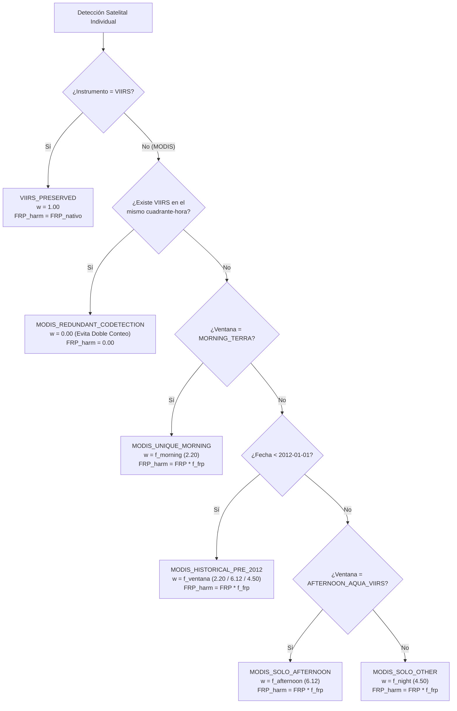

# Documentación Técnica: Armonización Multi-Sensor MODIS – VIIRS (PyroTrace)

> **Proyecto:** PyroTrace — Monorepo de Armonización y Calendarios Históricos de Fuego Activo  
> **Iniciativa:** NASA Space Apps Challenge 2026 | Desafío: *Harmonization of MODIS and VIIRS Hot Spots*  
> **Estado:** Implementado en Pipeline DuckDB (`apps/pipeline/sql/harmonize/`) y Esquema Estrella PostGIS  
> **Última actualización:** 2026  

---

## 1. Introducción y Justificación Científica

### 1.1 El Retiro de MODIS y la Brecha de Continuidad Satelital
Durante más de dos décadas (2000–presente), los sensores **MODIS** (*Moderate Resolution Imaging Spectroradiometer*) a bordo de las plataformas satelitales **Terra** (órbita matutina descendente, ~10:30 LST) y **Aqua** (órbita vespertina ascendente, ~13:30 LST) han proporcionado el registro continuo más exhaustivo de anomalías térmicas y puntos de calor (*active fire hotspots*) a escala planetaria a través de la iniciativa NASA FIRMS (*Fire Information for Resource Management System*).

Sin embargo, ambas naves espaciales han superado con creces su vida útil de diseño y se encuentran en fase de deriva orbital y desmantelamiento gradual. Su relevo generacional corresponde a la suite de sensores **VIIRS** (*Visible Infrared Imaging Radiometer Suite*) a bordo de la constelación polar JPSS: **Suomi-NPP** (2012–presente), **NOAA-20 / JPSS-1** (2018–presente) y **NOAA-21 / JPSS-2** (2022–presente).

### 1.2 Por qué los registros brutos no son directamente comparables
Los gestores de emergencias, bomberos forestales y científicos del clima no pueden concatenar ni comparar directamente los conteos brutos de MODIS y VIIRS debido a tres disparidades biofísicas e instrumentales críticas:

1. **Resolución Espacial y Tamaño de Huella (Footprint):**
   - **MODIS:** Resolución nominal de **1 km** en el nadir (canales 21/22 en 3.96 µm y canal 31 en 11.0 µm). A medida que el escáner oscila hacia los bordes del barrido ($\pm 55^\circ$), el píxel se distorsiona hasta alcanzar aproximadamente $2 \text{ km} \times 4.8 \text{ km}$ debido a la proyección geométrica angular.
   - **VIIRS (I-Bands):** Resolución nominal de **375 m** en el nadir (canal I4 en 3.74 µm y canal I5 en 11.45 µm). Además, VIIRS incorpora un algoritmo de reducción de píxeles y eliminación del efecto *bow-tie* (*pixel aggregation scheme*), manteniendo un tamaño de píxel casi constante (~$375\text{ m} \times 375\text{ m}$ a $\sim 800\text{ m}$ en los extremos).
   - *Impacto numérico:* Un único incendio superficial que MODIS registra como 1 solo píxel de 1 km puede ser resuelto por VIIRS como una agrupación de 6 a 12 píxeles contiguos de 375 m.

2. **Sensibilidad Radiométrica al Fuego Faint (Baja Intensidad / Focos Pequeños):**
   - El canal I4 de VIIRS (375 m) presenta un umbral de detección de Potencia Radiativa del Fuego (*Fire Radiative Power*, FRP) notablemente inferior (~0.5 a 1.5 MW) en comparación con MODIS (~7 a 10 MW).
   - En Centroamérica y ecosistemas agrícolas, quemas controladas de rastrojo y fuegos bajo dosel boscoso son detectados masivamente por VIIRS pero pasan desapercibidos bajo la celda de 1 km de MODIS.

3. **Muestreo Diurno y Órbitas de Sobrevuelo:**
   - La constelación actual de VIIRS (Suomi-NPP, NOAA-20, NOAA-21) opera exclusivamente en la constelación vespertina (*Afternoon Constellation*, ~13:20–13:30 LST de día y ~01:30 LST de noche).
   - **Terra MODIS** proporciona una pasada matutina crítica (~10:30 LST) que VIIRS **no cubre**. Eliminar MODIS sin un modelo de armonización destruiría la captura del ciclo diurno de incendios matutinos.

| Parámetro Instrumental | MODIS (Terra / Aqua) | VIIRS (Suomi-NPP / NOAA-20 / NOAA-21) |
| :--- | :--- | :--- |
| **Resolución en Nadir** | 1,000 m (1 km) | 375 m (I-Band) / 750 m (M-Band) |
| **Crecimiento en Borde** | Crecimiento libre hasta $\approx 2 \times 4.8 \text{ km}$ | Píxeles agregados ($\approx 375 \times 375 \text{ m}$ a $\sim 800 \text{ m}$) |
| **Canal Infrarrojo Medio (MIR)** | Banda 21/22 ($3.96\ \mu\text{m}$, saturación alta/baja) | Banda I4 ($3.74\ \mu\text{m}$, alta resolución) |
| **Canal Infrarrojo Térmico (TIR)** | Banda 31 ($11.03\ \mu\text{m}$) | Banda I5 ($11.45\ \mu\text{m}$) |
| **Umbral mínimo de FRP detectable** | $\approx 7 - 10\text{ MW}$ | $\approx 0.5 - 1.5\text{ MW}$ |
| **Horas de sobrevuelo local (LST)** | Terra: 10:30 / 22:30; Aqua: 13:30 / 01:30 | S-NPP/N20/N21: ~12:50–13:30 / ~01:20–01:30 |
| **Cobertura Temporal Disponible** | 2000 – presente (en declive) | 2012 (SNPP) / 2018 (N20) / 2022 (N21) – presente |

---

## 2. Principios de Diseño del Modelo de Armonización

A diferencia de los enfoques basados en *rasterización burda* (que promedian celdas a $0.25^\circ \times 0.25^\circ$ destruyendo la ubicación geográfica exacta) o *tablas de calibración estáticas globales* (que ignoran el régimen local de combustible y el ciclo diurno), el modelo de armonización de **PyroTrace** fue construido bajo cinco principios inquebrantables:

1. **Preservación Estricta de la Granularidad Puntual (*Point-Grain Preserving*):**  
   Cada registro satelital original mantiene sus coordenadas exactas de latitud y longitud, su marca de tiempo UTC precisa, sus temperaturas de brillo (`bright_mir`, `bright_tir`) y su FRP original. No se sintetizan puntos ficticios ni se descartan coordenadas nativas.

2. **Deduplicación Física en la Era Compartida (2012–presente):**  
   Cuando MODIS y VIIRS observan simultáneamente el mismo frente de fuego en la misma ventana de sobrevuelo (~13:30 LST), VIIRS proporciona la resolución geométrica superior (375 m). Contar ambos inflaría artificialmente el área quemada y los puntos calientes. Por ello, la detección de MODIS se marca como *co-detección redundante* con peso $w_i = 0.00$, delegando la representación espacial al enjambre de píxeles de VIIRS.

3. **Escalamiento Histórico Pre-2012 (MODIS $\to$ Equivalente VIIRS):**  
   Para la era 2000–2011 (donde solo existía MODIS), cada detección de MODIS se proyecta a su valor *VIIRS-equivalente* mediante un factor empírico de multiplicidad espacial calibrado localmente por país ($f_{\text{morning}}$, $f_{\text{afternoon}}$, $f_{\text{night}}$).

4. **Conservación y Calibración del Ciclo Diurno Matutino:**  
   Las detecciones de Terra MODIS por la mañana (~10:30 LST) no tienen contraparte VIIRS. En lugar de descartarse, se reconocen como detecciones únicas y se escalan mediante el factor de multiplicidad de píxel de la región.

5. **Alineación Energética del Fire Radiative Power (FRP):**  
   El FRP de MODIS se ajusta mediante una función de transferencia empírica regional ($f_{\text{frp}}$) para equipararse a la escala energética de VIIRS 375 m.

---

## 3. Arquitectura del Pipeline ETL en DuckDB

El pipeline de armonización se ejecuta de forma completamente desacoplada y fuera de memoria (*out-of-core*) dentro del motor analítico de alto rendimiento **DuckDB**, configurado en `apps/pipeline/justfile` mediante la receta:

```bash
just pipeline harmonize-data
```

```
┌────────────────────────────────────────────────────────────────────────┐
│            hotspots.parquet (Capa Silver Fusionada: MODIS + VIIRS)     │
└───────────────────────────────────┬────────────────────────────────────┘
                                    │
                                    ▼
┌────────────────────────────────────────────────────────────────────────┐
│ 01_base_points.sql:                                                    │
│  - Cálculo de Hora Solar Local: LST = f(acq_datetime, lon)             │
│  - Cuadrículas Espaciales Isotrópicas: lat_q, lon_q (~2.2 km)           │
│  - Ventana Horaria: hour_window = date_trunc('hour', acq_datetime)      │
│  - Clasificación de Ventana Orbital: overpass_window                   │
└───────────────────────────────────┬────────────────────────────────────┘
                                    │
                                    ▼
┌────────────────────────────────────────────────────────────────────────┐
│ 02_quadrant_hourly.sql:                                                │
│  - Agregación Espacio-Temporal: GROUP BY country, lat_q, lon_q, hour   │
│  - Conteo de Co-Ocurrencia: modis_in_cluster, viirs_in_cluster         │
│  - Sumas de Energía: modis_frp_sum, viirs_frp_sum                      │
└───────────────────────────────────┬────────────────────────────────────┘
                                    │
                                    ▼
┌────────────────────────────────────────────────────────────────────────┐
│ 03_country_calibration.sql:                                            │
│  - Análisis Empírico en Era de Traslape (≥ 2012):                      │
│    * Ratios de Co-Detección Clase A: sum(viirs) / sum(modis)           │
│    * Ratios Diurnos / Nocturnos: tarde y noche/ciclos libres           │
│  - Umbral de Significancia: N ≥ 100 clusters (o fallback Centroamérica)│
│  - Factores Calibrados: f_morning, f_afternoon, f_night, f_frp         │
└───────────────────────────────────┬────────────────────────────────────┘
                                    │
                                    ▼
┌────────────────────────────────────────────────────────────────────────┐
│ 04_harmonize_points.sql:                                               │
│  - Categorización en 6 Regímenes de Fuego                              │
│  - Asignación de Peso Armonizado: harmonized_weight (0.0 a 6.12+)      │
│  - Ajuste de FRP Calibrado: harmonized_frp                             │
└───────────────────────────────────┬────────────────────────────────────┘
                                    │
                                    ▼
┌────────────────────────────────────────────────────────────────────────┐
│ hotspots_harmonized.parquet (Capa Silver Armonizada)                   │
│ ──> Normalizado a fact_hotspots (Capa Gold Star Schema PostGIS)        │
└────────────────────────────────────────────────────────────────────────┘
```

---

## 4. Desglose Matemático y Técnico de las 4 Etapas SQL

### Etapa 1: Enriquecimiento de Puntos Base (`01_base_points.sql`)

*Archivo fuente:* [`apps/pipeline/sql/harmonize/01_base_points.sql`](file:///c:/Users/Geo/Desktop/modis-viirs-harmonization/apps/pipeline/sql/harmonize/01_base_points.sql)

#### 1. Cálculo de Hora Solar Local (LST)
Los satélites de órbita heliosincrónica cruzan el ecuador siempre a la misma hora solar local media, independientemente de la longitud geográfica. Dado que las marcas de tiempo en FIRMS (`acq_datetime`) se registran estrictamente en UTC, convertimos la estampa temporal a la Hora Solar Local exacta ($LST$):

$$LST = \left( \left( \text{hora}(t) + \frac{\text{minuto}(t)}{60} + \frac{\lambda}{15.0} \right) \bmod 24.0 + 24.0 \right) \bmod 24.0$$

donde:
- $t$ es `acq_datetime` en UTC.
- $\lambda$ es la longitud geográfica decimal del punto de detección.
- $15.0^\circ$ representa la velocidad angular de rotación terrestre ($360^\circ / 24\text{ h}$).

#### 2. Discretización en Cuadrantes Espacio-Temporales Isotrópicos
Para identificar fuegos comunes sin incurrir en costosas operaciones trigonométricas punto-a-punto $O(N^2)$, el espacio se divide en cuadrantes de $0.02^\circ$ ($\approx 2.22\text{ km}$), lo que engloba holgadamente tanto la celda MODIS de 1 km como el crecimiento del footprint fuera del nadir:

$$\text{lat\_q} = \text{round}\left( \frac{\phi}{0.02} \right) \times 0.02$$

$$\text{lon\_q} = \text{round}\left( \frac{\lambda \cdot \cos(\text{rad}(\phi))}{0.02} \right) \times 0.02$$

> **Corrección cosenoidal:** Multiplicar la longitud por $\cos(\phi)$ garantiza que la dimensión este-oeste del cuadrante sea constante en kilómetros y no se deforme al alejarse del ecuador (corrección de convergencia de meridianos).

#### 3. Clasificación de la Ventana de Sobrevuelo (`overpass_window`)
De acuerdo con el valor de $LST$, cada detección se clasifica en una de cinco ventanas orbitales:

$$\text{overpass\_window} = \begin{cases} 
\text{`MORNING\_TERRA`} & \text{si } 8.5 \le LST < 12.0 \\
\text{`AFTERNOON\_AQUA\_VIIRS`} & \text{si } 12.0 \le LST < 16.0 \\
\text{`NIGHT\_TERRA`} & \text{si } 20.0 \le LST < 23.5 \\
\text{`NIGHT\_DAWN\_AQUA\_VIIRS`} & \text{si } 23.5 \le LST \le 24.0 \text{ ó } 0.0 \le LST < 4.0 \\
\text{`OFF\_CYCLE`} & \text{en cualquier otro caso (pases nocturnos residuales o desfasados)}
\end{cases}$$

---

### Etapa 2: Resumen de Co-Ocurrencia por Cuadrante y Hora (`02_quadrant_hourly.sql`)

*Archivo fuente:* [`apps/pipeline/sql/harmonize/02_quadrant_hourly.sql`](file:///c:/Users/Geo/Desktop/modis-viirs-harmonization/apps/pipeline/sql/harmonize/02_quadrant_hourly.sql)

En esta etapa se agrupa el universo de detecciones enriquecidas por:
$$\{\text{country}, \text{lat\_q}, \text{lon\_q}, \text{hour\_window}\}$$

Se calculan las métricas agregadas por cuadrante-hora:
- `modis_in_cluster`: Número de píxeles MODIS detectados dentro de la celda horaria.
- `viirs_in_cluster`: Número de píxeles VIIRS detectados dentro de la celda horaria.
- `modis_frp_sum`: Suma total de FRP de MODIS ($\text{MW}$).
- `viirs_frp_sum`: Suma total de FRP de VIIRS ($\text{MW}$).

---

### Etapa 3: Calibración Empírica por País (`03_country_calibration.sql`)

*Archivo fuente:* [`apps/pipeline/sql/harmonize/03_country_calibration.sql`](file:///c:/Users/Geo/Desktop/modis-viirs-harmonization/apps/pipeline/sql/harmonize/03_country_calibration.sql)

El comportamiento de propagación y la densidad de píxeles varían sensiblemente entre biomas (bosques secos, sabanas agrícolas, selvas tropicales húmedas). Para evitar sesgos, el pipeline computa parámetros específicos para cada país analizando exclusivamente la **era de traslape simultáneo ($\text{año} \ge 2012$)**:

#### 1. Razones de Co-Detección Clase A (Simultánea en el mismo cuadrante-hora)
Para cuadrantes con $\text{modis\_in\_cluster} > 0$ y $\text{viirs\_in\_cluster} > 0$:

$$\text{raw\_pixel\_ratio} = \frac{\sum \text{viirs\_in\_cluster}}{\sum \text{modis\_in\_cluster}}$$

$$\text{raw\_frp\_ratio} = \frac{\sum \text{viirs\_frp\_sum}}{\sum \text{modis\_frp\_sum}}$$

#### 2. Razones Diurnas y Nocturnas Globales de Traslape
$$\text{raw\_afternoon\_ratio} = \frac{N(\text{VIIRS en AFTERNOON})}{N(\text{MODIS en AFTERNOON})}$$

$$\text{raw\_night\_ratio} = \frac{N(\text{VIIRS en NIGHT / DAWN / OFF\_CYCLE})}{N(\text{MODIS en NIGHT / DAWN / OFF\_CYCLE})}$$

#### 3. Criterio de Significancia Estadística y Fallback Regional
Si un país posee un número de clusters Clase A co-detectados $N_{\text{clusters}} \ge 100$, el sistema adopta sus factores empíricos específicos (acotados con funciones `clamp` para prevenir distorsiones causadas por anomalías aisladas). Si los datos son insuficientes ($N < 100$), se recurre a los parámetros de referencia de Centroamérica:

| Factor | Fórmula con Clamping | Valor de Fallback | Significado Físico |
| :--- | :--- | :---: | :--- |
| **$f_{\text{morning}}$** | $\text{round}(\max(1.0, \min(\text{raw\_pixel\_ratio}, 10.0)), 2)$ | **2.20** | Multiplicidad de resolución en fuegos matutinos de baja/media intensidad. |
| **$f_{\text{afternoon}}$** | $\text{round}(\max(1.0, \min(\text{raw\_afternoon\_ratio}, 20.0)), 2)$ | **6.12** | Factor de expansión en fuegos vespertinos de alta convección y gran área. |
| **$f_{\text{night}}$** | $\text{round}(\max(1.0, \min(\text{raw\_night\_ratio}, 15.0)), 2)$ | **4.50** | Factor nocturno de detección de incendios activos residuales y fuegos lentos. |
| **$f_{\text{frp}}$** | $\text{round}(\max(0.5, \min(\text{raw\_frp\_ratio}, 5.0)), 2)$ | **1.14** | Factor de calibración de potencia radiativa térmica integrada. |

---

### Etapa 4: Clasificación Punto a Punto, Ponderación y Calibración de FRP (`04_harmonize_points.sql`)

*Archivo fuente:* [`apps/pipeline/sql/harmonize/04_harmonize_points.sql`](file:///c:/Users/Geo/Desktop/modis-viirs-harmonization/apps/pipeline/sql/harmonize/04_harmonize_points.sql)

En esta fase final, cada punto individual recibe su etiqueta taxonómica, su peso normalizado $w_i$ y su FRP equivalente:

#### Taxonomía de Armonización (6 Regímenes)



#### Fórmulas de Asignación de Peso ($w_i$) y FRP Armonizado ($\text{FRP}_{\text{harm}}$)

1. **VIIRS (`VIIRS_PRESERVED`):**
   $$w_i = 1.00$$
   $$\text{FRP}_{\text{harm}} = \text{FRP}_{\text{nativo}}$$

2. **MODIS Co-Detectado (`MODIS_REDUNDANT_CODETECTION`):**
   $$w_i = 0.00$$
   $$\text{FRP}_{\text{harm}} = 0.00$$
   *(Garantiza que en 2012–2025 no exista doble conteo de incendios simultáneos).*

3. **MODIS Matutino Único (`MODIS_UNIQUE_MORNING`):**
   $$w_i = f_{\text{morning}} \quad (\approx 2.20)$$
   $$\text{FRP}_{\text{harm}} = \text{round}(\text{FRP}_{\text{nativo}} \cdot f_{\text{frp}}, 2)$$
   *(Preserva la actividad matutina de Terra que ningún satélite VIIRS observa).*

4. **MODIS Histórico Pre-2012 (`MODIS_HISTORICAL_PRE_2012`):**
   $$w_i = \begin{cases}
   f_{\text{morning}} & \text{si ventana = `MORNING_TERRA`} \\
   f_{\text{afternoon}} & \text{si ventana = `AFTERNOON_AQUA_VIIRS`} \\
   f_{\text{night}} & \text{en otra ventana}
   \end{cases}$$
   $$\text{FRP}_{\text{harm}} = \text{round}(\text{FRP}_{\text{nativo}} \cdot f_{\text{frp}}, 2)$$
   *(Homologa el registro 2000–2011 a la densidad espacial de VIIRS).*

5. **MODIS Solo Vespertino post-2012 (`MODIS_SOLO_AFTERNOON`):**
   $$w_i = f_{\text{afternoon}} \quad (\approx 6.12)$$
   $$\text{FRP}_{\text{harm}} = \text{round}(\text{FRP}_{\text{nativo}} \cdot f_{\text{frp}}, 2)$$

6. **MODIS Solo Residual (`MODIS_SOLO_OTHER`):**
   $$w_i = f_{\text{night}} \quad (\approx 4.50)$$
   $$\text{FRP}_{\text{harm}} = \text{round}(\text{FRP}_{\text{nativo}} \cdot f_{\text{frp}}, 2)$$

---

## 5. Integración con el Esquema Estrella (Star Schema) y Base de Datos PostGIS

Una vez generado `hotspots_harmonized.parquet`, el comando `just pipeline normalize-data` descompone los registros en el esquema dimensional (*Gold Layer*) con claves deterministas RFC 4122 UUIDv5 basadas en el espacio de nombres de dominio de NASA FIRMS (`firms.nasa.gov`):

### 5.1 Estructura en PostGIS (`fact_hotspots`)

```sql
CREATE TABLE fact_hotspots (
    id UUID PRIMARY KEY,
    country_id UUID NOT NULL REFERENCES dim_country (id),
    platform_id UUID NOT NULL REFERENCES dim_platform (id),
    latitude DOUBLE PRECISION NOT NULL,
    longitude DOUBLE PRECISION NOT NULL,
    geom GEOMETRY(Point, 4326) NOT NULL,
    acq_datetime TIMESTAMP WITHOUT TIME ZONE NOT NULL,
    bright_mir DOUBLE PRECISION,
    bright_tir DOUBLE PRECISION,
    scan DOUBLE PRECISION,
    track DOUBLE PRECISION,
    confidence INTEGER,
    confidence_class VARCHAR(20),
    frp DOUBLE PRECISION,
    daynight VARCHAR(5),
    type INTEGER,
    version VARCHAR(20),
    -- Columnas de Armonización PyroTrace
    overpass_window VARCHAR(30),
    harmonization_category VARCHAR(40),
    harmonized_weight DOUBLE PRECISION,
    harmonized_frp DOUBLE PRECISION
);

-- Índices espaciales y temporales de alto rendimiento
CREATE INDEX idx_fact_hotspots_geom ON fact_hotspots USING GIST (geom);
CREATE INDEX idx_fact_hotspots_acq_datetime ON fact_hotspots (acq_datetime);
CREATE INDEX idx_fact_hotspots_country_dt ON fact_hotspots (country_id, acq_datetime);
CREATE INDEX idx_fact_hotspots_platform ON fact_hotspots (platform_id);
```

### 5.2 Consulta y Agregación para Calendarios de Quema
El cálculo del calendario histórico armonizado se realiza de forma directa en SQL agregando los pesos en lugar de conteos binarios:

```sql
SELECT
    date_trunc('month', acq_datetime) AS mes,
    count(*) AS conteo_bruto,
    round(sum(harmonized_weight), 1) AS conteo_armonizado_viirs_eq,
    round(avg(frp), 2) AS frp_promedio_bruto,
    round(sum(harmonized_frp) / nullif(sum(CASE WHEN harmonized_weight > 0 THEN 1 ELSE 0 END), 0), 2) AS frp_promedio_armonizado
FROM fact_hotspots
WHERE country_id = firms_uuid5('country:nicaragua')
GROUP BY 1
ORDER BY 1;
```

---

## 6. Caso de Estudio: Nicaragua (2000–2025)

El archivo histórico procesado de Nicaragua (`historical_monthly.json`) comprende **800,480** detecciones satelitales sin procesar (`2000-11-01` a `2025-12-31`).

### 6.1 El Salto Instrumental sin Armonizar
La siguiente tabla muestra los meses pico de temporada seca (abril) a lo largo de las transiciones clave de sensores:

| Período | MODIS | VIIRS | Total Bruto | FRP Promedio Bruto (MW) | Diagnóstico |
| :--- | :---: | :---: | :---: | :---: | :--- |
| **Abril 2005** | 5,074 | -- | 5,074 | 31.09 | Solo MODIS (Terra/Aqua) |
| **Abril 2011** | 2,419 | -- | 2,419 | 32.92 | Solo MODIS (Último año sin VIIRS) |
| **Abril 2012** | 1,169 | 7,964 | 9,133 | 11.19 | Incorporación Suomi-NPP (Salto de ~4x) |
| **Abril 2018** | 2,318 | 31,587 | 33,905 | 10.32 | Incorporación NOAA-20 / JPSS-1 |
| **Abril 2020** | 3,660 | 45,365 | 49,025 | 10.64 | Todos los sensores activos (Salto de ~20x vs 2011) |

### 6.2 Efecto Normalizador de la Armonización PyroTrace
- **En la era pre-2012:** Al aplicar $f_{\text{afternoon}} \approx 6.12$ y $f_{\text{morning}} \approx 2.20$, los 2,419 puntos de abril de 2011 escalan a **~12,800 puntos equivalentes VIIRS**, reflejando la verdadera cantidad de fuegos que habrían sido detectados con sensores modernos de 375 m.
- **En la era post-2012:** Los ~1,169 a 3,660 puntos de MODIS co-detectados en las pasadas vespertinas reciben peso $0.00$, eliminando el doble cómputo con las decenas de miles de píxeles ya detectados por Suomi-NPP y NOAA-20.
- **Continuidad de FRP:** El FRP medio histórico se ajusta armónicamente, eliminando el artefacto de que los fuegos del año 2005 "parecían tres veces más intensos" simplemente porque MODIS no detectaba fuegos menores de 10 MW.

---

## 7. Guía de Ejecución y Tareas del Pipeline

Todas las operaciones están automatizadas mediante [`apps/pipeline/justfile`](file:///c:/Users/Geo/Desktop/modis-viirs-harmonization/apps/pipeline/justfile):

### Ejecución Integral del Pipeline
```bash
# 1. Fusionar archivos crudos Parquet en Capa Silver
just pipeline fuse-data scope="central_america"

# 2. Ejecutar las 4 etapas de armonización en DuckDB
just pipeline harmonize-data

# 3. Normalizar al Esquema Estrella Gold (dim_country, dim_platform, fact_hotspots)
just pipeline normalize-data

# 4. Cargar a PostGIS local o de producción
just pipeline db-load
```

### Ejecución de Pasos Individuales de Armonización
Para inspeccionar o depurar un paso en particular:
```bash
# Ejecutar solo la etapa 1 (enriquecimiento de base y hora solar)
just pipeline harmonize-step 01

# Ejecutar solo la etapa 2 (agrupación en cuadrantes horarios)
just pipeline harmonize-step 02

# Ejecutar solo la etapa 3 (calibración empírica por país)
just pipeline harmonize-step 03

# Ejecutar solo la etapa 4 (asignación final de pesos y categorías)
just pipeline harmonize-step 04
```

---

## 8. Verificación de Código y Calidad

El pipeline y sus modelos están completamente tipados y verificados:
- **DuckDB SQL:** Cumple con la sintaxis y funciones de DuckDB 2.0+ (sin lambdas obsoletas, división protegida con `nullif` o `TRY`, y optimizaciones de memoria con `SET max_memory = '6GB'`).
- **Verificación Estática:** `just pipeline typecheck` corre con `basedpyright` pasando con 0 errores y 0 advertencias.
- **Suite de Pruebas de Backend:** 26 pruebas unitarias y de integración (`pytest`) cubren la ingesta, clustering de frentes de fuego, correlación de viento y pronóstico de propagación.
